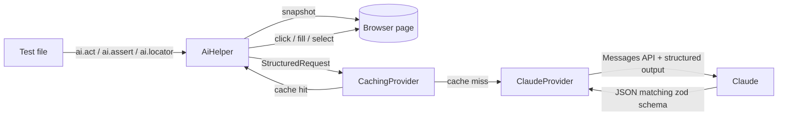

# Architecture

## Overview



The AI layer sits **beside** Playwright, not in place of it. Tests still use `page`, `expect`,
page objects and traces. `ai` is one more fixture you reach for when it helps.

## Components

### `AiHelper` ([src/ai/AiHelper.ts](../src/ai/AiHelper.ts))

The public API. Each method follows the same pattern:

1. **Observe:** capture the page state (element list, accessibility tree, and/or screenshot).
2. **Ask:** send a `StructuredRequest` with a short system prompt and a zod schema.
3. **Act or report:** run the chosen browser action, or return the verdict or data.

| Method | Page context sent | Schema returned |
|---|---|---|
| `act(instruction)` | numbered element list and the step history, in a loop | `{done, action, elementId, value, reasoning}` |
| `check(statement)` / `assert(statement)` | full-page screenshot and accessibility tree | `{pass, reasoning}` |
| `extract(what, schema)` | accessibility tree | caller's schema |
| `locator(selector, description)` | numbered element list, only on failure | `{elementId, confidence, reasoning}` |

### Page snapshot ([src/ai/snapshot.ts](../src/ai/snapshot.ts))

Runs in the browser and lists every visible interactive element. Each element is tagged with a
`data-ai-id` attribute and rendered as one line:

```
[3] <button data-test="add-to-cart-sauce-labs-backpack"> "Add to cart" | in: "Sauce Labs Backpack carry.allTheThings() … $29.99"
```

**Why ids instead of letting the model write selectors:** the model can only pick something that
exists. A hallucinated CSS selector is impossible. The `in:` context tells apart the six identical
"Add to cart" buttons.

### Providers ([src/ai/provider.ts](../src/ai/provider.ts))

`AiProvider` is a one-method interface: `structured(request) → typed result`.

- **`ClaudeProvider`** calls `client.beta.messages.parse()` with `betaZodOutputFormat(schema)`,
  so the response is validated against the zod schema before any test code sees it. It checks
  for `stop_reason: "refusal"` and enables server-side `fallbacks: "default"`, which retries a
  declined request on a fallback model in the same call.
- **`CachingProvider`** hashes model + prompt + screenshot and stores the answer under `.ai-cache/`.
- **`ScriptedProvider`** (tests/offline) is a fake that returns queued answers. It lets the whole
  AI layer be unit tested with no network and no key.

### Fixture ([src/fixtures.ts](../src/fixtures.ts))

Adds `ai` to Playwright's `test`. It skips the test when no credentials are set, and it
attaches a `self-healing-report.json` to the HTML report when any locator was healed.

## Design decisions

| Decision | Why | Trade-off |
|---|---|---|
| Structured outputs with zod everywhere | No regex parsing of model text. A malformed answer fails loudly. | Slightly more schema code |
| One action per model call in `act()` | The model sees the result of each step, so it can recover from popups, navigation, or a failed click. | More calls than planning all steps at once |
| Element ids, not generated selectors | Prevents hallucinated selectors | Needs a DOM snapshot on every step |
| Screenshot and accessibility tree for assertions | The screenshot catches visual bugs. The tree gives exact text. | Larger requests |
| Healing returns a durable selector | The test author can paste the fix back. Healing is a safety net, not a permanent crutch. | Needs good `data-test` attributes in the app |
| Response cache on by default | Faster, free, deterministic re-runs | A stale cache can hide a change in model behavior; use `AI_CACHE=off` for a fresh run |
| `effort: low` by default | UI steps are simple. `low` keeps latency and cost down. | Raise `AI_EFFORT` for complex visual judgments |
| Three test projects | Shows AI tests next to a non-AI control group and keeps CI green without a key | None worth noting |
